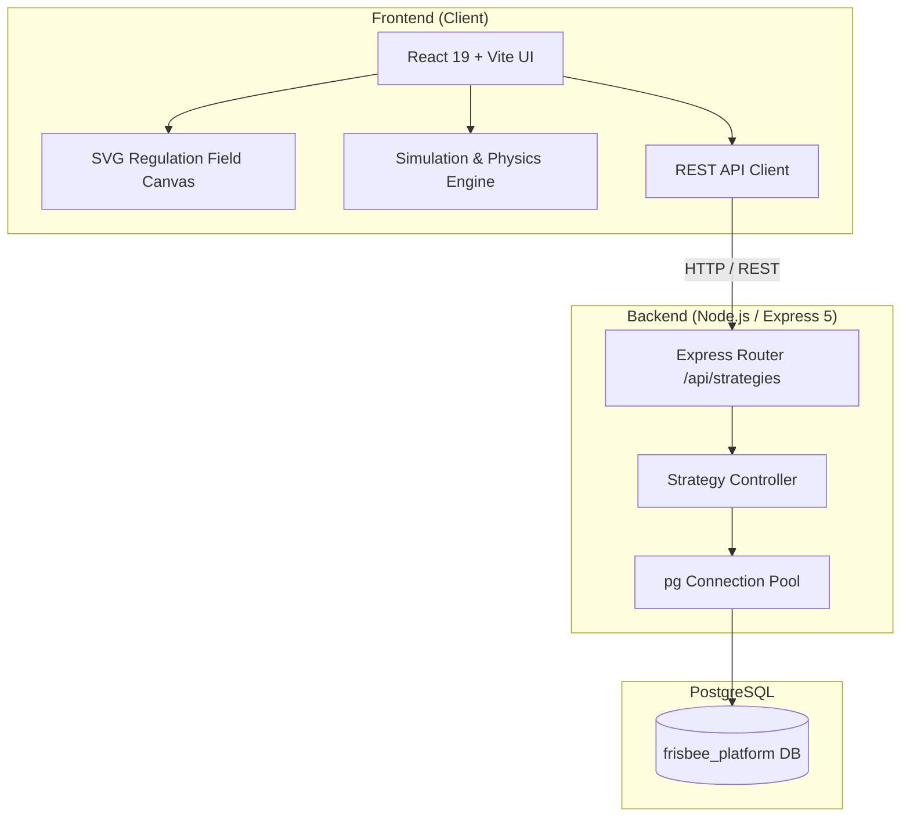

# 🥏 Ultimate Frisbee Strategy Simulation Platform

An interactive full-stack web application designed for Ultimate Frisbee coaches, captains, and players to design, simulate, record, and analyze set plays and tactical formations.

Built with **React 19**, **Vite**, **Node.js**, **Express 5**, and **PostgreSQL**.

---

## 📋 Table of Contents

- [Overview](#overview)
- [Key Features](#key-features)
- [System Architecture](#system-architecture)
- [Tech Stack](#tech-stack)
- [Project Structure](#project-structure)
- [Getting Started](#getting-started)
  - [Prerequisites](#prerequisites)
  - [Database Setup](#database-setup)
  - [Backend Setup](#backend-setup)
  - [Frontend Setup](#frontend-setup)
- [API Reference](#api-reference)
- [Simulation & Physics Engine](#simulation--physics-engine)
  - [Coordinate System](#coordinate-system)
  - [Player Path Interpolation (LERP)](#player-path-interpolation-lerp)
  - [Disc Flight Mechanics & Bezier Curves](#disc-flight-mechanics--bezier-curves)
- [Strategy JSON Schema](#strategy-json-schema)
- [License](#license)

---

## 🌟 Overview

Coaching Ultimate Frisbee often relies on whiteboard diagrams or static playbooks that fail to capture the fluid timing and curved disc trajectories of real games.

This platform bridges that gap by offering:
- **Interactive SVG Field Canvas**: Regulation dimensions (100m × 37m) with millimeter precision.
- **Dynamic 7v7 Simulation**: Control 14 players (7 Offense, 7 Defense) and the disc.
- **Live Path Recording**: Click and draw actual running cuts and defensive shading in real time.
- **Realistic Disc Physics**: Simulate inside-out and outside-in curved passes with variable apex height and flight times.
- **Multi-Keyframe Timeline**: Scrub through sequences, add keyframes, and play back plays at multiple speeds (0.5x to 2x).
- **Persistent Cloud Storage**: Save, browse, and load strategy playbooks backed by PostgreSQL.
- **Export & Import**: Share portable JSON play files with teammates.

---

## 🚀 Key Features

### 1. Interactive Regulation Field
- Full-scale Ultimate field conforming to standard dimensions:
  - Total length: **100 meters** (64m playing field proper + two 18m endzones).
  - Width: **37 meters**.
  - Regulation markings including endzone goal lines and brick marks.
- Crisp vector rendering using responsive SVG canvas with pointer drag-and-drop support.

### 2. Player Roster & Freehand Recording
- **14 Players**: 7 Offense (`O1`–`O7`, Blue) and 7 Defense (`D1`–`D7`, Red).
- **Freehand Path Recording**: Toggle Record Mode, drag a player across the field, and capture high-frequency timestamped waypoints.
- **Real-time Path Smoothing**: Playback smoothly interpolates recorded routes between waypoints.

### 3. Disc Physics & Throw Engine
- Quadratic Bézier curve flight paths simulate realistic disc curves (Inside-Out / Outside-In).
- Configurable throw parameters:
  - **Receiver**: Select any player on the field to target.
  - **Duration**: Flight time in seconds.
  - **Curvature**: Adjust shape and lateral deviation.
  - **Apex Height**: Parabolic altitude simulation with live flight elevation indicator and dynamic ground shadow.
- Automatic possession handover when the disc reaches its destination.

### 4. Timeline & Keyframe Animation
- Keyframe-based sequencing with arbitrary time steps.
- Timeline scrubber supporting continuous playback (Play / Pause / Reset).
- Variable playback speeds: `0.5x`, `1.0x`, `1.5x`, and `2.0x`.
- Linear interpolation (LERP) between keyframes for all players simultaneously.

### 5. Persistence & Sharing
- **PostgreSQL Database Storage**: Save strategies directly to the backend database with timestamps.
- **Strategy Library**: Browse and load existing plays from the database.
- **JSON Import / Export**: Download strategy files to share with coaches or upload existing strategies with strict schema validation.

---

## 🏗️ System Architecture



---

## 🛠️ Tech Stack

### Frontend
- **Framework**: [React 19](https://react.dev/)
- **Build Tool**: [Vite 8](https://vitejs.dev/)
- **Graphics**: Scalable Vector Graphics (SVG) with Pointer Events
- **Styling**: Modern CSS3 (CSS Grid, Flexbox, CSS Variables)

### Backend
- **Runtime**: [Node.js](https://nodejs.org/) (v18+)
- **Framework**: [Express 5](https://expressjs.com/)
- **Database Client**: [`pg`](https://node-postgres.com/) (node-postgres connection pool)
- **Middleware**: `cors`, `dotenv`
- **Dev Tooling**: `nodemon`

### Database
- **Database Engine**: [PostgreSQL](https://www.postgresql.org/) (v14+)
- **Data Model**: JSONB strategy storage with relational audit metadata

---

## 📁 Project Structure

```
Strategy_Simulation/
├── README.md                  # Project documentation
├── backend/                   # Express REST API
│   ├── .env                   # Database and port configuration
│   ├── package.json           # Backend dependencies and scripts
│   └── src/
│       ├── server.js          # Express app entrypoint & middleware
│       ├── db/
│       │   └── pool.js        # PostgreSQL pg.Pool connection config
│       ├── routes/
│       │   └── strategyRoutes.js  # CRUD routes (/api/strategies)
│       └── controllers/
│           └── strategyController.js # Strategy business logic & SQL queries
│
└── frontend/                  # React + Vite application
    ├── index.html             # HTML entry point
    ├── package.json           # Frontend dependencies and scripts
    ├── vite.config.js         # Vite configuration
    └── src/
        ├── main.jsx           # React DOM root
        ├── App.jsx            # Main app shell
        ├── App.css            # Global styling
        ├── api/
        │   └── strategies.js  # Fetch API client functions
        ├── components/
        │   ├── Field.jsx      # Core interactive SVG field and controls
        │   ├── Player.jsx     # Player token SVG component
        │   └── Disc.jsx       # Disc token, shadow, and height indicator
        ├── models/
        │   └── strategy.js    # Data models, field constants, validator
        └── simulation/
            ├── interpolation.js # Keyframe LERP & sample interpolator
            └── discPhysics.js   # Bézier flight paths & elevation math
```

---

## 🚦 Getting Started

### Prerequisites

Ensure you have installed:
- **Node.js** (v18.0.0 or higher) & **npm**
- **PostgreSQL** (v14 or higher)

---

### Database Setup

1. Start your local PostgreSQL service:
   ```bash
   sudo systemctl start postgresql
   ```

2. Create the platform database and user:
   ```bash
   psql -U postgres
   ```

   Inside the PostgreSQL console:
   ```sql
   CREATE DATABASE frisbee_platform;
   CREATE USER demo WITH ENCRYPTED PASSWORD '2005@Rohan';
   GRANT ALL PRIVILEGES ON DATABASE frisbee_platform TO demo;
   \c frisbee_platform
   GRANT ALL ON SCHEMA public TO demo;
   ```

3. Create the `strategies` table:
   ```sql
   CREATE TABLE IF NOT EXISTS strategies (
     id SERIAL PRIMARY KEY,
     name VARCHAR(255) NOT NULL,
     strategy_data JSONB NOT NULL,
     created_at TIMESTAMPTZ DEFAULT NOW(),
     updated_at TIMESTAMPTZ DEFAULT NOW()
   );
   ```

---

### Backend Setup

1. Navigate to the `backend` directory:
   ```bash
   cd backend
   ```

2. Install dependencies:
   ```bash
   npm install
   ```

3. Configure environment variables in `backend/.env`:
   ```env
   PORT=5000
   DB_HOST=localhost
   DB_PORT=5432
   DB_NAME=frisbee_platform
   DB_USER=demo
   DB_PASSWORD=2005@Rohan
   ```

4. Start the backend development server:
   ```bash
   npm run dev
   ```
   *The API will start on [http://localhost:5000](http://localhost:5000).*

---

### Frontend Setup

1. In a new terminal, navigate to the `frontend` directory:
   ```bash
   cd frontend
   ```

2. Install dependencies:
   ```bash
   npm install
   ```

3. Start the Vite development server:
   ```bash
   npm run dev
   ```
   *The UI will be available at [http://localhost:5173](http://localhost:5173).*

4. (Optional) To build for production:
   ```bash
   npm run build
   ```

---

## 📡 API Reference

Base URL: `http://localhost:5000`

| Method | Endpoint | Description | Sample Response / Status |
| :--- | :--- | :--- | :--- |
| `GET` | `/` | Root info status | `200 OK` |
| `GET` | `/api/health` | Backend server health check | `200 OK` |
| `GET` | `/api/db-health` | PostgreSQL database connection health check | `200 OK` |
| `GET` | `/api/strategies` | List all saved strategies (metadata only) | `200 OK` `[{ id, name, created_at, updated_at }]` |
| `POST` | `/api/strategies` | Create and save a new strategy | `201 Created` |
| `GET` | `/api/strategies/:id` | Fetch full strategy data by ID | `200 OK` `{ strategy: { id, name, strategy_data, ... } }` |
| `PUT` | `/api/strategies/:id` | Update an existing strategy by ID | `200 OK` |
| `DELETE` | `/api/strategies/:id` | Delete a strategy by ID | `200 OK` |

---

## 🧮 Simulation & Physics Engine

### Coordinate System

The simulation operates in real-world metric units on a 2D plane:
- **Field Length ($X$)**: `0.0m` to `100.0m`
  - West Endzone: `0.0m` – `18.0m`
  - Playing Field Proper: `18.0m` – `82.0m`
  - East Endzone: `82.0m` – `100.0m`
- **Field Width ($Y$)**: `0.0m` to `37.0m`
- **SVG Canvas**: Automatically scales metric coordinates via SVG `viewBox="0 0 100 37"`, ensuring zero distortion across all screen resolutions.

---

### Player Path Interpolation (LERP)

Between keyframes, player coordinates $(x, y)$ are computed using Linear Interpolation:

$$\text{lerp}(a, b, \alpha) = a + (b - a) \cdot \alpha$$

where the normalized time parameter $\alpha$ is:

$$\alpha = \frac{t - t_{\text{start}}}{t_{\text{end}} - t_{\text{start}}} \quad (\alpha \in [0, 1])$$

For freehand recorded movement tracks, continuous position sampling queries the piecewise linear segments between recorded timestamps.

---

### Disc Flight Mechanics & Bezier Curves

When a pass event occurs from player $P_{\text{from}}$ to player $P_{\text{to}}$, the 2D planar position follows a Quadratic Bézier curve:

$$B(t) = (1 - t)^2 P_{\text{start}} + 2(1 - t)t P_{\text{control}} + t^2 P_{\text{end}} \quad (t \in [0, 1])$$

The perpendicular control point $P_{\text{control}}$ dictates the curve intensity:

$$P_{\text{control}} = \left(\frac{x_{\text{start}} + x_{\text{end}}}{2} - \frac{\Delta y}{d} \cdot c, \; \frac{y_{\text{start}} + y_{\text{end}}}{2} + \frac{\Delta x}{d} \cdot c\right)$$

where $d = \sqrt{\Delta x^2 + \Delta y^2}$ is the pass distance and $c$ is the curvature parameter.

#### Flight Altitude Profile
The disc's height $h(t)$ off the ground follows a parabolic arc reaching apex height $h_{\max}$:

$$h(t) = 4 \cdot h_{\max} \cdot t(1 - t)$$

- At release ($t = 0$): $h(0) = 0\text{ m}$
- At apex ($t = 0.5$): $h(0.5) = h_{\max}$
- At catch ($t = 1$): $h(1) = 0\text{ m}$

The elevation is displayed directly on the disc label, and an SVG drop shadow expands and fades proportionally with altitude.

---

## 📄 Strategy JSON Schema

Exported strategies adhere to a strict versioned JSON format:

```json
{
  "version": 1,
  "name": "Vertical Stack Deep Cut",
  "field": {
    "length": 100,
    "width": 37,
    "endzoneLength": 18
  },
  "players": [
    { "id": "O1", "number": 1, "team": "offense", "x": 25.0, "y": 18.5 },
    { "id": "D1", "number": 1, "team": "defense", "x": 27.0, "y": 18.5 }
  ],
  "disc": {
    "holderId": "O1"
  },
  "keyframes": [
    {
      "time": 0,
      "positions": {
        "O1": { "x": 25.0, "y": 18.5 },
        "D1": { "x": 27.0, "y": 18.5 }
      }
    },
    {
      "time": 2.5,
      "positions": {
        "O1": { "x": 25.0, "y": 18.5 },
        "D1": { "x": 35.0, "y": 10.0 }
      }
    }
  ],
  "movements": [
    {
      "id": "mov_1",
      "playerId": "O2",
      "startTime": 0,
      "endTime": 2.5,
      "samples": [
        { "x": 30.0, "y": 18.5, "time": 0 },
        { "x": 42.0, "y": 12.0, "time": 1.2 },
        { "x": 55.0, "y": 8.0, "time": 2.5 }
      ]
    }
  ],
  "events": [
    {
      "id": "throw_1",
      "type": "throw",
      "fromPlayerId": "O1",
      "toPlayerId": "O2",
      "startTime": 1.0,
      "endTime": 2.5,
      "curvature": 4.5,
      "maxHeight": 3.2
    }
  ]
}
```

---

## 📝 License

This project is licensed under the [ISC License](backend/package.json).
